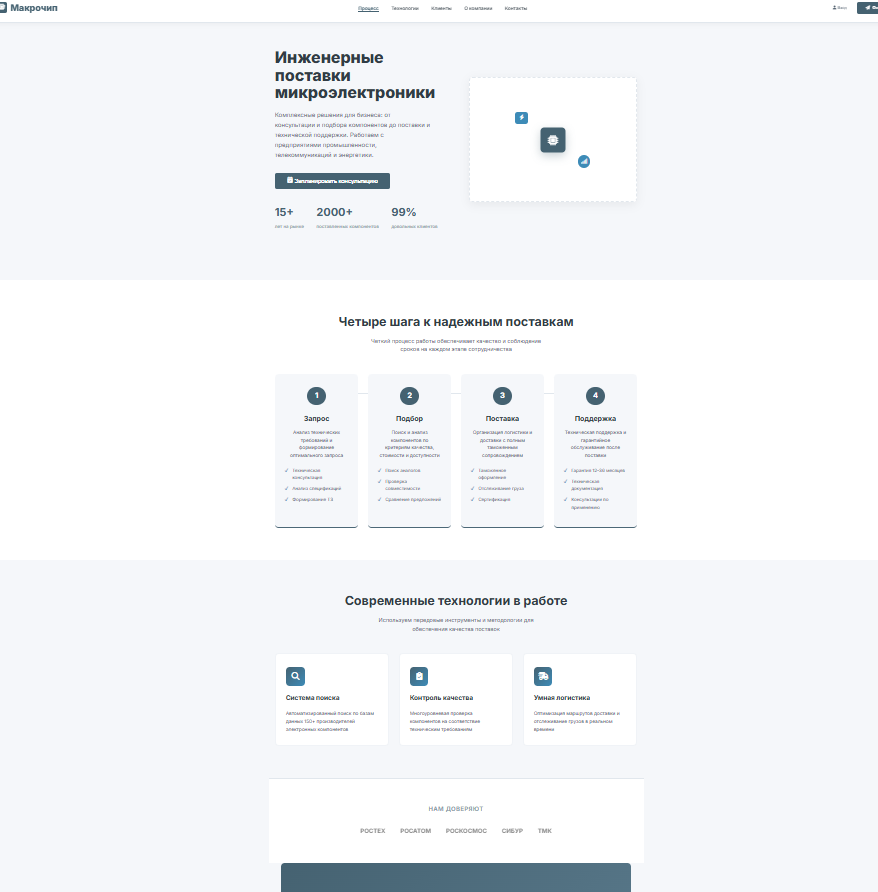
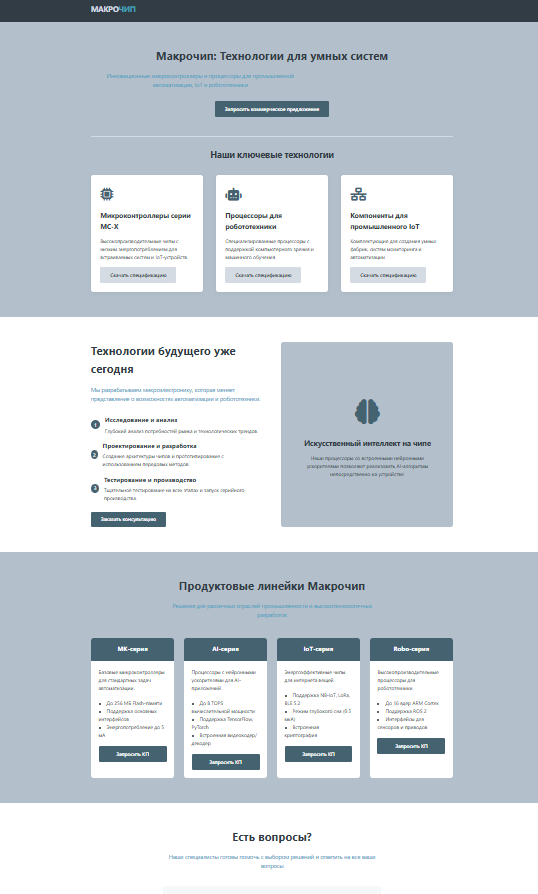
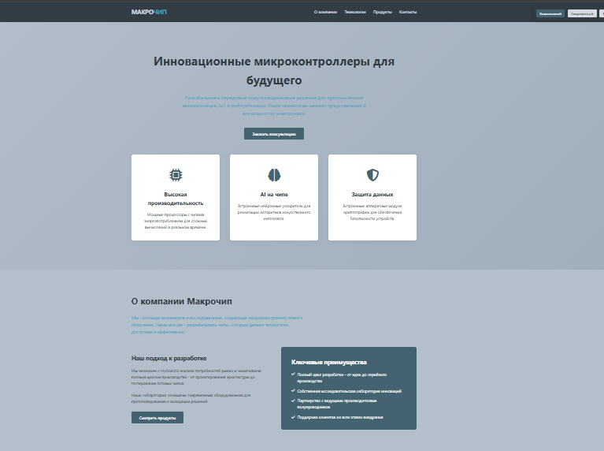
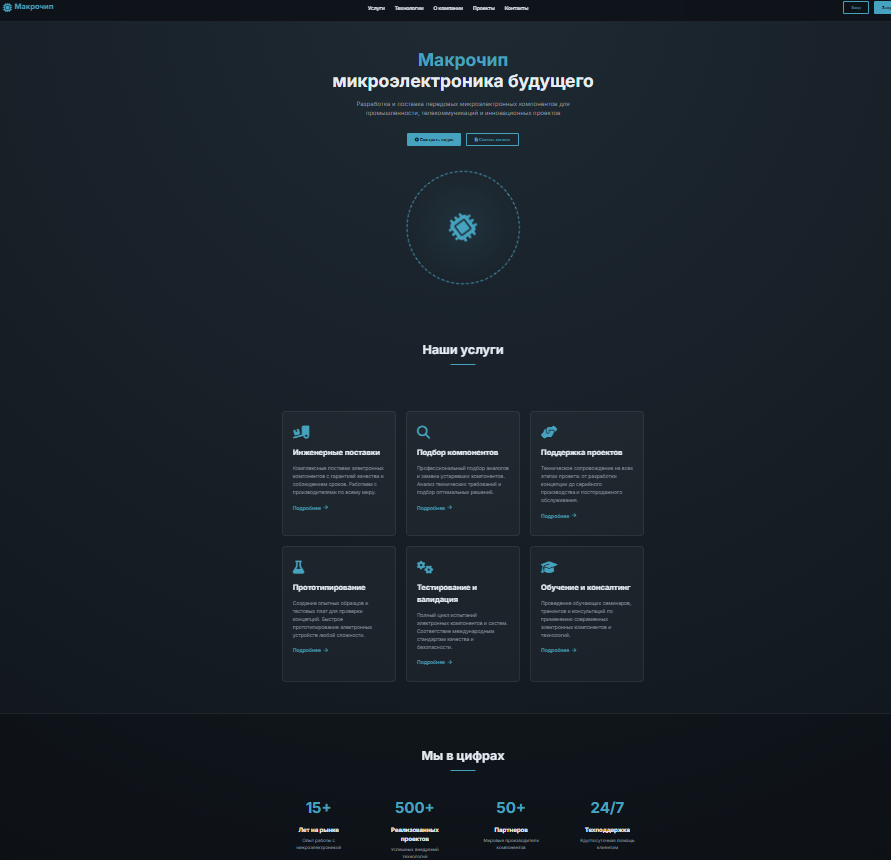
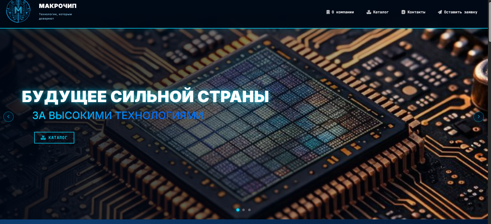

Корпоративный сайт-визитка для компании-поставщика электронных компонентов: 
лендинг с баннерным слайдером, каталогом категорий, контактным блоком 
и формой заявки с серверной обработкой и капчей.

> 📌 Это **обезличенная версия для портфолио**. Все реальные данные компании 
> (реквизиты, адреса, телефоны, email, ключи, доступы, дампы, логи) удалены 
> или заменены на placeholder'ы. Название «Ромашка» — вымышленный плейсхолдер, 
> использованный вместо настоящего названия компании.
>
> 🔗 **Оригинальный сайт:** https://macrochip.ru/  
> Проект выполнен для компании, которой принадлежат права на оригинальный сайт 
> и его контент. Название компании в коде намеренно не используется.

---

## 🧩 Моя роль

Проект сделан **с нуля**: от идеи и айдентики до вёрстки и серверной части.

- 🎨 **Разработка логотипа** компании
- 📘 **Составление брендбука**: палитра, типографика, правила использования лого, тон коммуникации
- 🖌 **Разработка фирменного стиля** и UI-кита (сетки, кнопки, карточки, иконки, эффекты)
- 🧭 **Проектирование структуры** сайта и пользовательских сценариев
- 🖼 **Отрисовка макетов** и итерационная работа над внешним видом (см. раздел «Эволюция дизайна»)
- 💻 **Вёрстка с нуля**: HTML5, CSS3, JavaScript (vanilla) — адаптив, слайдер, анимации, мобильное меню
- ⚙️ **Серверная часть на PHP**: обработка формы, валидация, логирование, отправка писем
- 🔌 **Интеграция PHPMailer (SMTP)** и **Google reCAPTCHA v2**
- 🧪 **Рефакторинг и обезличивание** кода перед публикацией в портфолио

---

## 🎨 Айдентика и брендбук

В рамках проекта разработано:

- **Логотип** — знак + текстовый блок
- **Цветовая палитра** — тёмная техно-тема с акцентными градиентами
- **Типографика** — Inter (интерфейс) + JetBrains Mono (технические подписи)
- **Фирменные эффекты** — grid-overlay, scan-line, анимированные иконки
- **UI-кит** — карточки, бейджи, кнопки, формы, состояния

Брендбук описывает правила использования лого, отступы, сетки, 
тональность текста и визуальные паттерны — всё это применено в макете сайта.

---
## 🖼 Эволюция дизайна

Перед финальной версией было сделано **несколько итераций макета**, 
которые также написаны мной для компании. Код этих разметок — по запросу. 
Скриншоты лежат в папке `design-iterations/`.

| Файл | Что проверялось | Итог |
|------|-----------------|------|
| `style1.png` | базовая структура, крупные блоки, минимум декора | стало ясно, что не хватает «техно»-атмосферы |
| `style2.png` | тёмная тема, сетка-оверлей, неоновые акценты | визуал понравился, но навигация была перегружена |
| `style4.png` | слайдер-баннер, компактная навигация, карточки каталога | стал основой для финальной вёрстки |
| `fin.png` | финальный дизайн-макет | утверждён как итоговый |
| `result.png` | реализация финального макета в коде | итоговый вид сайта |

**Галерея итераций:**

| v1 | v2 | v3 | v4 | Финал |
|----|----|----|----|-------|
|  |  |  |  |  |

## 🛠 Стек

| Слой | Технологии |
|------|------------|
| Frontend | HTML5, CSS3, JavaScript (vanilla) |
| Иконки и шрифты | Font Awesome 6, Google Fonts (Inter, JetBrains Mono) |
| Backend | PHP |
| Почта | PHPMailer 6.x (SMTP) |
| Защита форм | Google reCAPTCHA v2 |
| Менеджер зависимостей | Composer |

---

## ✨ Основные возможности

- **Баннерный слайдер** на главной: изображения + видео-слайд, стрелки, индикаторы
- **Адаптивная навигация** с мобильным меню
- **Секция «О компании»** со статистикой
- **Каталог** категорий компонентов с бейджами (ПОПУЛЯРНО / СКЛАД / НОВИНКА)
- **Контактный блок** с часами работы, техподдержкой и условиями работы
- **Форма заявки** с клиентской и серверной валидацией
- **reCAPTCHA v2** для защиты от спама
- **Логирование** заявок и ошибок отправки почты
- Кнопка «наверх», grid/scan-эффекты, анимированные иконки

---

## 📁 Структура проекта

```
site/
├── index.html              # Основная страница
├── send.php                # Обработчик формы заявки
├── composer.json           # Зависимости проекта
├── composer.lock           # Зафиксированные версии
├── .htaccess               # Правила Apache
├── .gitignore              # Исключения для Git
├── includes/
│   ├── config.php          # Конфигурация (SMTP, reCAPTCHA)
│   └── functions.php       # Вспомогательные функции
├── assets/
│   ├── css/
│   │   └── style.css
│   ├── js/
│   │   └── script.js
│   └── img/img/
│       ├── logo.png
│       ├── banner1.png
│       ├── banner2.png
│       ├── banner3.png
│       └── ban3.mp4
├── design-iterations/        # Скриншоты итераций дизайна
│   ├── style1.png
│   ├── style2.png
│   ├── style4.png
│   └── fin.png

├── vendor/                 # Composer-зависимости (PHPMailer)
└── logs/                   # Создаётся автоматически (не коммитить!)
    ├── debug.log
    ├── requests.log
    └── mail_errors.log
```

> ⚠️ **Важно:** в публичной версии все секреты заменены на placeholder'ы. 
> Не коммить реальные ключи в репозиторий.


## ⚖️ Лицензия и условия использования

**© Темирова Ангелина. Все права защищены.**

Код опубликован **исключительно в ознакомительных целях** — для демонстрации 
навыков и подхода к работе в составе портфолио.

**Разрешается:**
- ✅ Просматривать код
- ✅ Изучать его структуру и подходы

**Запрещается без письменного разрешения автора:**
- ❌ Копировать код полностью или частично
- ❌ Использовать в коммерческих и некоммерческих проектах
- ❌ Распространять, публиковать, перепродавать
- ❌ Создавать производные работы
- ❌ Выдавать код за свой

Права на оригинальный сайт, его контент, логотип и фирменный стиль 
принадлежат компании-заказчику. Название «Ромашка» использовано 
исключительно как плейсхолдер и не является реальным названием компании.

Сторонние зависимости распространяются под своими лицензиями:

- PHPMailer — LGPL-2.1
- Font Awesome — CC BY 4.0 / SIL OFL 1.1 / MIT
- Google Fonts — SIL OFL 1.1

По вопросам использования кода: см. контакты ниже.

---

## 📬 Контакты

**Автор:** Темирова Ангелина  
**Email:** temirovaangelina00@gmail.com  
**GitHub:** [dedzh](https://github.com/dedzh?tab=repositories)